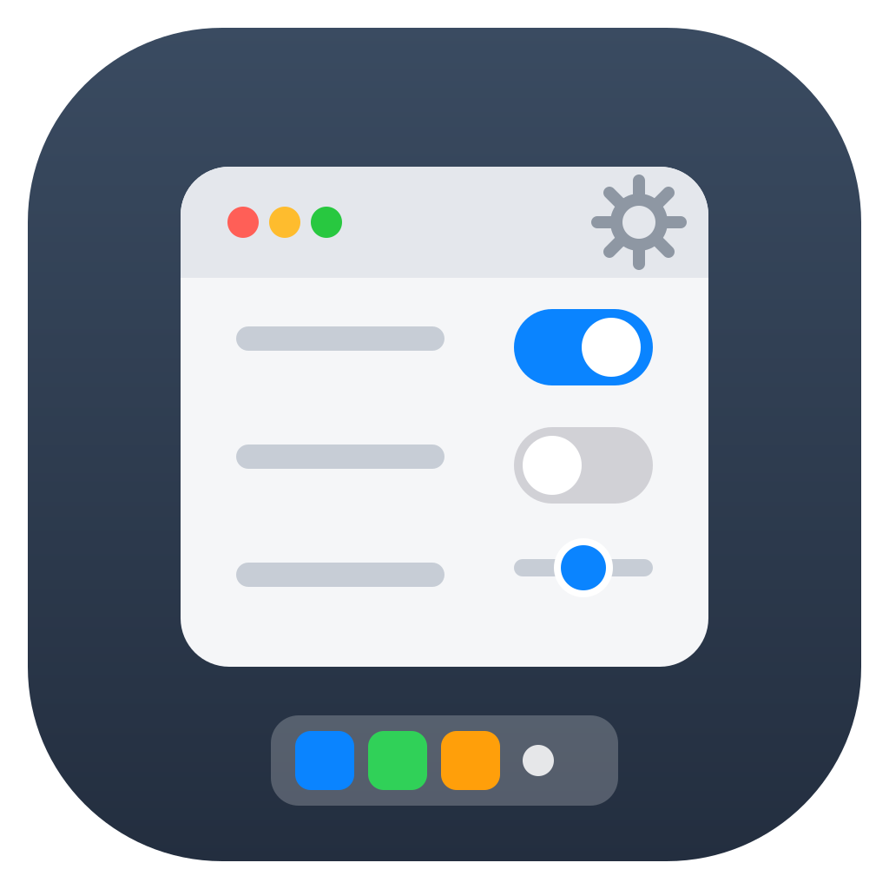

<div align="center">

  <h1>SwiftDefaults</h1>

  

  <p><b>Tweak macOS without touching Terminal.</b></p>

  <p>
    A native Mac utility for browsing and toggling system defaults.<br/>
    Open source, revert-safe.
  </p>

<p>
  <a href="https://github.com/wiggly-sheets/swiftdefaults/actions/workflows/ci.yml"></a>
  <a href="#license"></a>
  <a href="https://github.com/wiggly-sheets/swiftdefaults/releases/latest"></a>
</p>

  <p>
    <a href="#download"><b>Download</b></a>
    &nbsp;·&nbsp;
    <a href="#installation">Install guide</a>
    &nbsp;·&nbsp;
    <a href="#build-from-source">Build from source</a>
    &nbsp;·&nbsp;
    <a href="#security">Security</a>
  </p>

</div>

---

Your Mac hides dozens of useful settings behind `defaults write` commands. SwiftDefaults catalogs them, explains each in plain English, and applies them with one Apply.

> [!NOTE]
> Every change is revertible. SwiftDefaults captures the value present when it reads your settings at launch, and restores it on Revert — deleting the key when it did not exist, so the system default returns.

You do not need to know what a domain or plist key is. But if you want to check, the `id`, `domain` and `key` of every tweak live in [`SwiftDefaults/Resources/tweaks.json`](SwiftDefaults/Resources/tweaks.json), so any value can be verified with `defaults read <domain> <key>` first.

> [!NOTE]
> The latest release is 1.0.1. Download the DMG below, or install via Homebrew.

---

## Features

### Categorized tweaks

93 tweaks across 21 categories (Dock, Finder, Screenshots, Window Manager, Keyboard, and more):

- Human-readable title plus plain-English description per tweak
- Sidebar groups tweaks into System, Input and Apps, and shows a count on subcategory rows only
- Search across title, description, key, category, domain and id

### Staged edits, one Apply

- Flip a switch to stage the new value; nothing writes until Apply
- Apply writes all pending edits via `/usr/bin/defaults`, keeping failures staged
- Reset discards pending edits and reverts every setting this session applied
- Live state: each launch reads current values with one `defaults export <domain> -` per domain, falling back to `defaults read` per key when a domain will not parse
- Status dot shows whether the "on" value is active

### Revert safety

- The original value is captured on first read at launch
- **Revert** button restores the captured value, or deletes the key when it did not exist
- Revert appears on a row only after Apply has written that key in the current session

### Restart guidance

- Rows declaring `appToRestart` show "Takes effect after X relaunches"
- Rows needing a wider relaunch flag `requiresRelaunch`
- The app never force-restarts anything for you

### Registry-driven

- All tweaks live in one JSON file: `SwiftDefaults/Resources/tweaks.json`
- Adding a tweak is a JSON edit, no Swift changes needed
- Option lists (`options`) document valid values for multi-choice settings

---

## Download

Download `SwiftDefaults-1.0.1.dmg` for macOS 15+ (Apple Silicon) from the [Releases page](https://github.com/wiggly-sheets/swiftdefaults/releases).

It is **unsigned and not notarized**: no signing identity is used in this repo or in the release workflow, so Gatekeeper will block it on first open. Right-click the app and choose Open, or build from source. Signing and notarization are on the [Roadmap](#roadmap).

The release page also carries a checksum file, `SwiftDefaults-1.0.1.dmg.sha256`. Verify the download against it:

```bash
shasum -a 256 -c SwiftDefaults-1.0.1.dmg.sha256
```

Or install via Homebrew:

```bash
brew install --cask wiggly-sheets/homebrew-tap/swiftdefaults
```

Homebrew carries the updates. To move to a newer release:

```bash
brew update && brew upgrade --cask swiftdefaults
```

---

## Installation

Two ways to run SwiftDefaults: a double-clickable `.app` bundle, or straight from the terminal.

### Run from terminal (fastest)

```bash
git clone https://github.com/wiggly-sheets/swiftdefaults.git
cd swiftdefaults
make run
```

This builds a debug binary and launches it via `swift run`.

### Install manually

Build the app bundle, then move it to Applications:

```bash
make app-bundle
cp -r SwiftDefaults.app /Applications/
```

Then double-click **SwiftDefaults** in Applications. No Xcode required — only the Swift toolchain.

The bundle is unsigned, so macOS blocks the first open. Right-click **SwiftDefaults** in Applications, choose **Open**, then confirm.

---

## Updating

No updater yet. To update a source install:

```bash
cd swiftdefaults
git pull
make run
```

If you copied `SwiftDefaults.app` to Applications, rebuild and replace it:

```bash
git pull
make app-bundle
cp -r SwiftDefaults.app /Applications/
```

Your revert history is per-launch (in memory), so updating resets it. Applied system settings are untouched by updates.

---

## Build from source

### Prerequisites

- macOS 15 or later (Apple Silicon; see [Requirements](#requirements))
- Swift 6 toolchain (`swift --version` should print 6.x; ships with Xcode 16+ or swift.org)
- No Xcode project step needed — Swift Package Manager is canonical

### Step 1: Clone the repo

```bash
git clone https://github.com/wiggly-sheets/swiftdefaults.git
cd swiftdefaults
```

### Step 2: Build and run

```bash
make run
```

Or step by step:

```bash
swift build
swift run
```

### Make targets

| Target | Command | Output |
|--------|---------|--------|
| `build` | `swift build` | Debug binary in `.build/debug/` |
| `run` | `swift run` | Builds and launches the app |
| `release` | `swift build -c release` | Optimized binary in `.build/release/` |
| `app-bundle` | builds + assembles `.app` | `SwiftDefaults.app` in repo root |
| `app-bundle-debug` | builds + assembles `.app` | `SwiftDefaults-Debug.app` in repo root |
| `run-bundle-debug` | builds + assembles `.app`, then opens it | Runs `SwiftDefaults-Debug.app` |
| `clean` | `swift package clean` | Clears build artifacts |

`make app-bundle` wraps the release binary with `Info.plist`, `AppIcon.icns` and the SwiftPM resource bundle that carries `tweaks.json` into a launchable `SwiftDefaults.app`.

### Running the tests

The suite lives in `Tests/SwiftDefaultsTests/` and covers the parsing and registry contracts — 30 tests. Run it with:

```bash
swift test
```

### Sanity-checking the registry

```bash
jq length SwiftDefaults/Resources/tweaks.json
jq '[.[].category] | unique' SwiftDefaults/Resources/tweaks.json
```

---

## Requirements

- macOS 15.0 or later
- Apple Silicon (arm64) only — the app and the DMG are built for arm64, and this is the only tested configuration
- Write access to user defaults (no Full Disk Access, no sandbox entitlements beyond default)

---

## Privacy

SwiftDefaults runs entirely on your Mac. The registry, live reads, and revert history stay in memory or the local bundle. Nothing is uploaded, and file contents are never read.

---

## Security

SwiftDefaults writes system settings, so caution applies:

- **Revert by default**: the value present at launch is captured; Revert restores it or deletes a key the app created.
- **Explicit engine only**: writes go through `/usr/bin/defaults` with typed flags (`-bool`, `-int`, `-string`, `-float`). No shell strings, no `sh -c`.
- **You choose what goes**: the app shows what each toggle does; nothing applies at launch or in bulk.
- **Open source**: the full write path (`DefaultsEngine`) and registry are in this repo to read or build yourself.
- **Notarization: not yet** — releases are unsigned until the [Roadmap](#roadmap) items land. Building from source is the verifiable path today.

> [!CAUTION]
> Some entries carry their own `CAUTION` in the description (e.g. quarantine warnings, auto-empty Bin, experimental appearance keys). Read the row before toggling. A few tweaks need their target app relaunched, or a logout, to take effect.

Found a wrong default value or a risky entry? See [Support](#support).

---

## Roadmap

- [ ] Signed + notarized DMG on GitHub Releases
- [x] Homebrew cask
- [x] Test suite (`swift test`)
- [ ] Dry-run preview (show command before executing)
- [ ] Import/export profiles

---

## License

This project is licensed under [MIT](LICENSE).

---

## Support

Report bugs, wrong default values and risky entries in the [issue tracker](https://github.com/wiggly-sheets/swiftdefaults/issues).

Include the tweak `id`, your macOS version and the `defaults read <domain> <key>` output, so the entry can be reproduced.

---

## Documentation

- [Architecture](docs/ARCHITECTURE.md) — MVVM flow, reading live values, staging and revert model
- [Changelog](CHANGELOG.md) — what changed in each release
